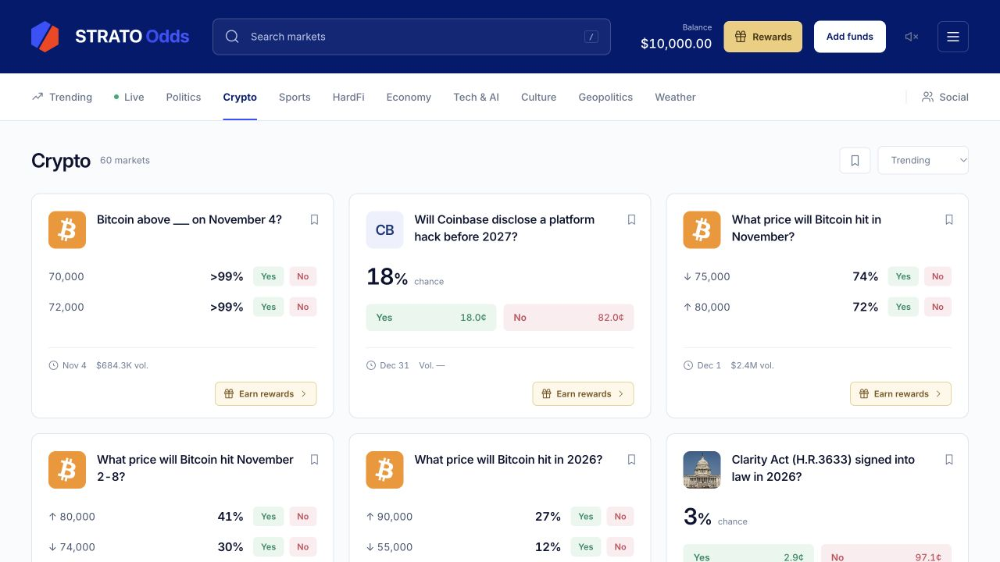

# STRATO Odds · design-to-production handoff

This repository contains the **exact runnable local design reference** and the instructions an AI coding agent needs to implement that experience in the real STRATO Odds application.

It is a handoff repository, not a deployment of the real trading application. The production repository was not available through the connected GitHub account when this package was prepared. No production files or contracts have been inspected or changed. Do not mistake a new branch in this repository for a branch already based on production.

Public repository: https://github.com/ShibaColin/strato-odds-social-redesign

Handoff branch: `codex/odds-social-redesign-handoff`. This is separate from the real application repository.

## Start here

1. **Run the reference:** `python3 reference/server.py --port 4173`, then open http://127.0.0.1:4173. Python 3 and curl are required. There are no npm dependencies.
2. **Give your AI** [AI_IMPLEMENTATION_PROMPT.md](AI_IMPLEMENTATION_PROMPT.md), this entire repository, and access to the real application repository. The AI must inspect the real app first.
3. Use [docs/IMPLEMENTATION_PLAN.md](docs/IMPLEMENTATION_PLAN.md) as the work sequence and [docs/ACCEPTANCE.md](docs/ACCEPTANCE.md) as the completion criteria.
4. Compare the implementation with `reference/public/` and the screenshots in `design/`. Keep the exact official logos, Inter font, WAV sounds and approved visual hierarchy.

**If you only want to explore the design:** double-click `reference/Start-STRATO-Odds.command` on macOS, or run the Python command above. The reference account starts with simulated USDST; it never submits a real order or wallet transaction.

## What is included

| Path | Purpose |
|---|---|
| `reference/` | Byte-identical application source, original assets, live read-only feeds, offline snapshots and 21 tests from the reviewed local version |
| `AGENTS.md` | Rules for an AI working in this handoff repository |
| `AI_IMPLEMENTATION_PROMPT.md` | Copy/paste task for the AI working in the production repository |
| `docs/DESIGN_SPEC.md` | Layout, tokens, components and interaction map back to the exact source |
| `docs/IMPLEMENTATION_PLAN.md` | Ordered migration tasks with explicit production boundaries |
| `docs/INTEGRATION_CONTRACTS.md` | Required adapter semantics and state models; not invented existing production endpoints |
| `docs/ACCEPTANCE.md` | Visual, functional, live-data and production-readiness checks |
| `docs/PROVENANCE.md` | What is real data, simulated state, original branding and third-party reference media |
| `design/` | Screenshots of the current reference; changing market values are not golden assertions |
| `REFERENCE_MANIFEST.json` | SHA-256 hashes of every file in `reference/` |
| `scripts/verify_reference.py` | Verifies exact reference bytes, required files, syntax and the test suite |
| `scripts/install_handoff.py` | Copies only this isolated handoff folder into a production checkout; dry-run by default |
| `docs/IMPORT_INTO_PRODUCT_REPO.md` | Safe branch/import steps for the real repository |

## Current experience

Topics across the header and a menu for app sections; large banners and cards; fixed date/volume slots and a separate Live badge; a gold Rewards header action and consistent gold incentive accents. Buy/Sell/Earn detail pages include real probability history, a 15-minute Live view, fine autoscale, trader entry overlays, live order books, a unified ticket/spin-progress block and easy liquidity entry. Supported crypto price questions also show a separate real USD spot-price strip.

Social includes theses, conviction and attached markets, replies, following, saved posts, reposts, market proposals/votes and real RSS news. Traders has day/month/all-time profit, volume and win-rate views. Rewards has a wheel, maker incentives, missions, referral and research incentives. Portfolio contains positions, orders, liquidity, activity and export. Sound is opt-in and uses three original STRATO bell motifs.



More design views: [desktop and mobile screenshots](design/README.md).

## Essential production distinction

Live public market quotes, history, order books, spot ticks and RSS are connected. **Balances, order execution, local LP quotes, social users/posts, trader entries, leaderboards, reward budgets and awards are simulation fixtures.** The optional local X adapter is not production OAuth/account infrastructure. Instagram exports a sharecard; it does not auto-publish.

The production task is to preserve this design while wiring truthful production state into the real app's architecture. It is not to copy a Python localhost broker or a localStorage ledger into production. The production app's existing wallets, signing, chain indexers, oracle/resolution source, escrow and settlement remain authoritative.

## Verify

```sh
python3 scripts/verify_reference.py --run-tests
```

Node.js 18+ is required for the 21 tests. The Python script verifies the manifest and JavaScript syntax without third-party Python packages. Visual checks are documented in `docs/ACCEPTANCE.md`.

## Sharing and branches

The handoff has its own Git history and branch `codex/odds-social-redesign-handoff`. A ZIP can be sent directly to developers; it contains all source and assets. A Git bundle preserves the commit and branch and can be cloned without GitHub. Instructions for importing under `design-handoff/strato-odds-next/` are included. A production PR should be made from the real repository's current integration branch after inspection; do not merge unrelated standalone histories into the application's root.
